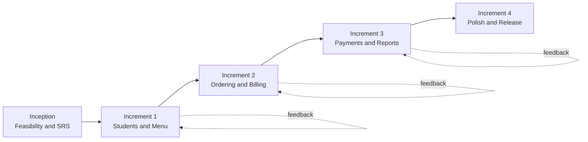
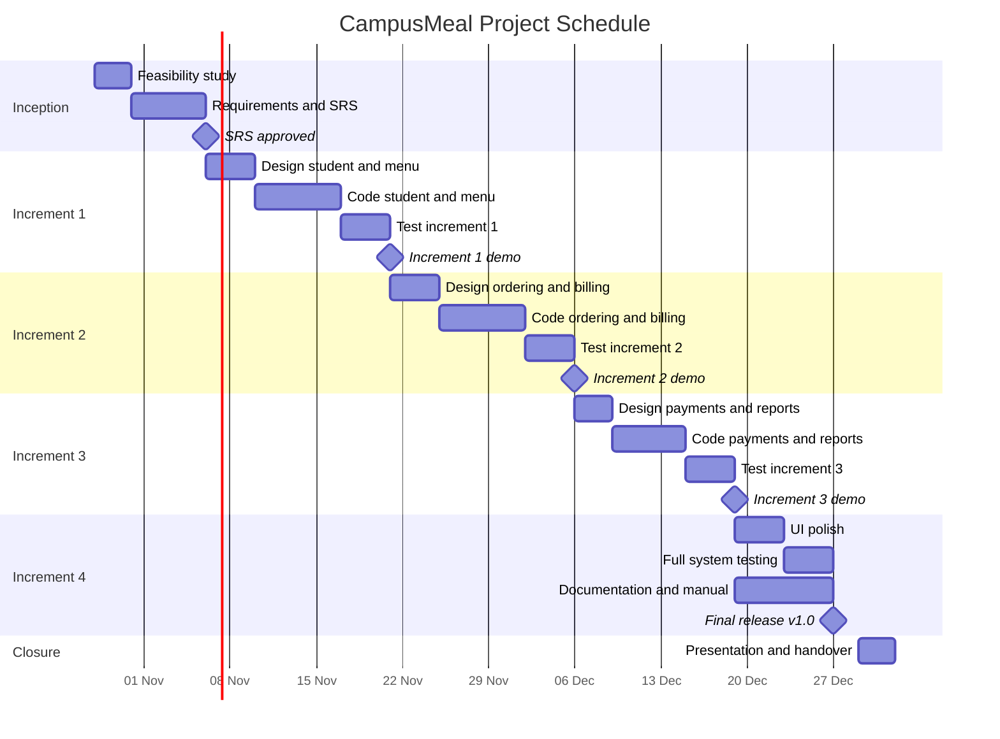
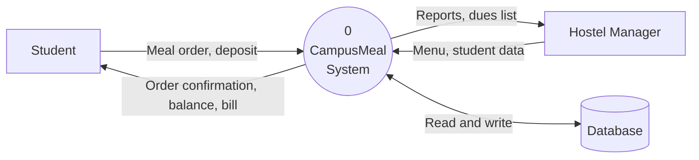
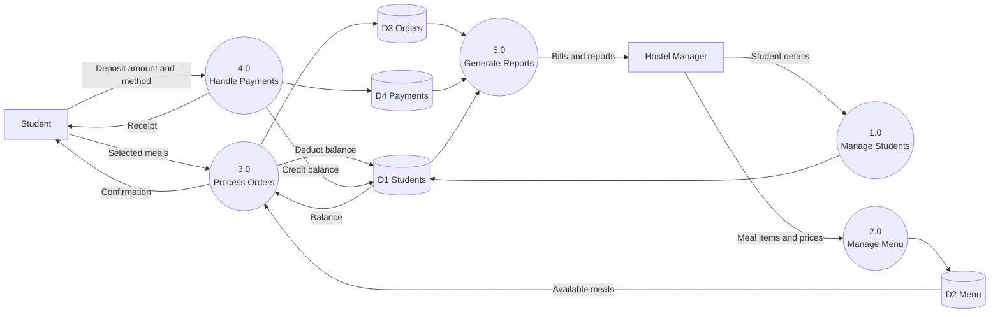
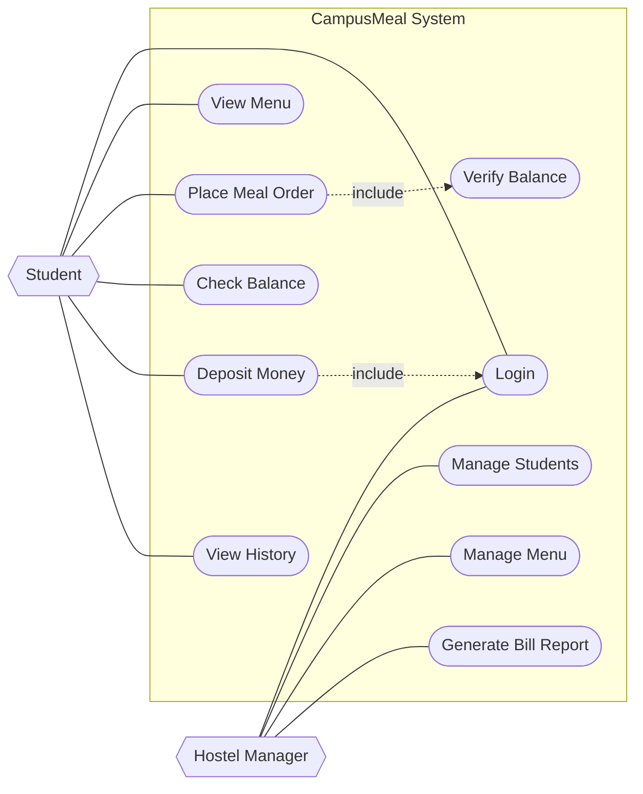
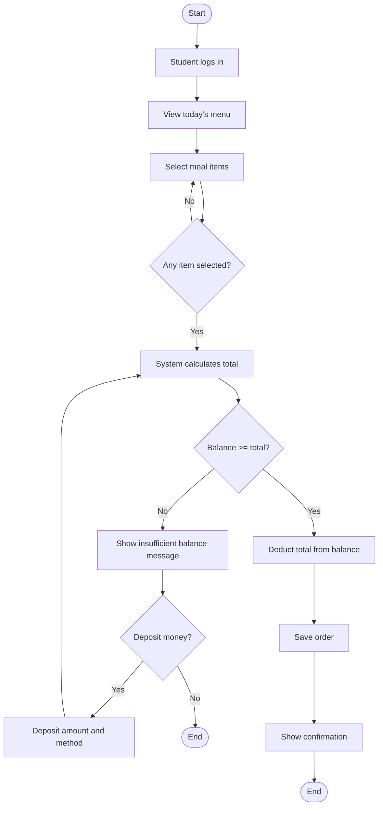
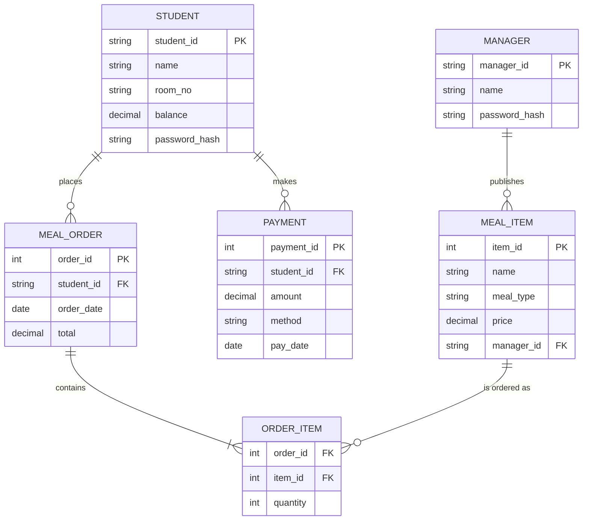
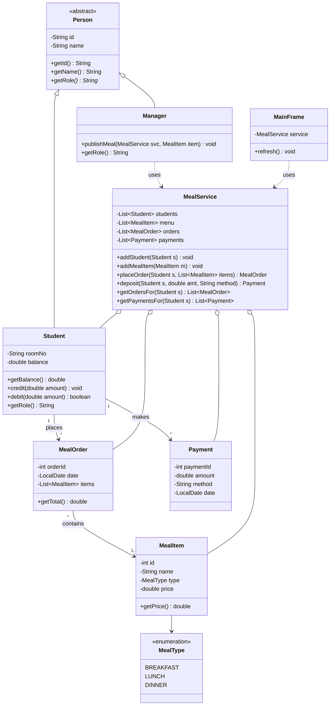
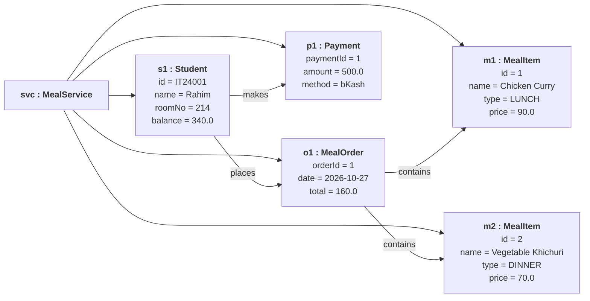

# CampusMeal: Hostel Meal Management System

**Final Capstone Project, Part I: Proposal and Prototype**

| | |
|---|---|
| **Course** | Software Engineering / Java Programming |
| **Institution** | Mawlana Bhashani Science and Technology University (MBSTU) |
| **Student** | _Your Name_, _Your ID_ |
| **Submission date** | 27 October 2026 |
| **Process model** | Iterative and Incremental Model |

---

## Table of Contents
1. [Abstract](#1-abstract)
2. [Problem Statement](#2-problem-statement)
3. [Objectives](#3-objectives)
4. [Scope](#4-scope)
5. [Stakeholders](#5-stakeholders)
6. [Requirements](#6-requirements)
7. [Technology Stack](#7-technology-stack)
8. [Software Process Model](#8-software-process-model)
9. [Project Schedule, Milestones and Deliverables](#9-project-schedule-milestones-and-deliverables)
10. [Gantt Chart](#10-gantt-chart)
11. [Risk Analysis](#11-risk-analysis)
12. [Effort and Resource Estimation](#12-effort-and-resource-estimation)
13. [UML Diagrams](#13-uml-diagrams)
14. [Prototype](#14-prototype)
15. [Testing Plan](#15-testing-plan)
16. [Conclusion](#16-conclusion)
17. [References](#17-references)

---

## 1. Abstract
CampusMeal is a desktop application that digitizes meal management in university residential halls. Today, hostel managers record daily meals, deposits and dues in paper registers, which causes calculation errors, disputes over bills and a large administrative workload. CampusMeal lets a manager publish the meal menu, lets students place meal orders against a prepaid balance, records every deposit, and produces accurate bills and reports automatically.

## 2. Problem Statement
- Meal counts and monthly bills are calculated manually, so mistakes are common.
- Students cannot easily check their balance, dues or meal history.
- Managers spend hours each month collecting records and preparing bills.
- There is no reliable audit trail for deposits and meal charges.

## 3. Objectives
1. Replace paper registers with a single digital system.
2. Allow students to order meals and see their balance in real time.
3. Prevent over-ordering by checking the balance before confirming an order.
4. Record every deposit (Cash, bKash, Nagad) with date and method.
5. Generate order history and billing reports for managers.

## 4. Scope
**In scope:** student records, menu management, meal ordering, balance and payments, order and payment history, basic reports.

**Out of scope (future work):** online payment gateway integration, mobile app, SMS notifications, biometric attendance.

## 5. Stakeholders
| Stakeholder | Interest |
|---|---|
| Student | Easy ordering, transparent balance and bills |
| Hostel Manager | Less paperwork, accurate billing and reports |
| Hall Provost / Administration | Accountability and audit trail |
| Developer (me) | Deliver a working, well-documented system |

## 6. Requirements

### 6.1 Functional Requirements
| ID | Requirement | Priority |
|---|---|---|
| FR1 | The system shall allow a manager to add, edit and remove student records. | High |
| FR2 | The system shall allow a manager to publish meal items with type and price. | High |
| FR3 | The system shall allow a student to select meal items and place an order. | High |
| FR4 | The system shall reject an order if the student's balance is insufficient. | High |
| FR5 | The system shall record deposits with amount, method and date. | High |
| FR6 | The system shall show a student's balance, order history and payment history. | Medium |
| FR7 | The system shall generate a monthly bill report per student. | Medium |
| FR8 | The system shall provide login for students and managers. | Medium |

### 6.2 Non-Functional Requirements
| ID | Requirement |
|---|---|
| NFR1 | **Usability:** a new user should place an order in under 1 minute. |
| NFR2 | **Performance:** any screen action responds within 2 seconds for up to 1,000 students. |
| NFR3 | **Reliability:** data must not be lost on application close (persistent storage). |
| NFR4 | **Security:** passwords stored hashed; role-based access. |
| NFR5 | **Portability:** runs on any OS with Java 17 or later. |
| NFR6 | **Maintainability:** object-oriented design with documented classes. |

## 7. Technology Stack
| Layer | Technology |
|---|---|
| Language | Java 17 |
| GUI | Java Swing |
| Storage (prototype) | In-memory collections |
| Storage (final) | SQLite via JDBC |
| Version control | Git and GitHub |
| Diagrams | Mermaid (rendered by GitHub) |
| Testing | JUnit 5 |

## 8. Software Process Model
**Chosen model: Iterative and Incremental.**

Requirements are fairly clear but may be refined after feedback from the hostel manager, so the system is built in four increments. Each increment goes through design, implementation and testing, and produces a working version.



**Why this model:** early working software, easy to absorb change, lower risk than a single big delivery (Waterfall), and suited to a solo student project.

## 9. Project Schedule, Milestones and Deliverables

| Phase | Activities | Start | End | Deliverable |
|---|---|---|---|---|
| Inception | Feasibility study, requirement gathering, SRS | 28 Oct | 05 Nov | SRS document |
| Increment 1 | Design, code and test Student and Menu modules | 06 Nov | 20 Nov | Working student and menu management |
| Increment 2 | Design, code and test Ordering and Billing | 21 Nov | 05 Dec | Working order flow with balance check |
| Increment 3 | Design, code and test Payments and Reports | 06 Dec | 18 Dec | Deposit module and bill reports |
| Increment 4 | UI polish, full testing, documentation | 19 Dec | 28 Dec | Final system, user manual |
| Closure | Final presentation and GitHub release | 29 Dec | 31 Dec | Final report and source code |

### Milestones
| ID | Milestone | Date |
|---|---|---|
| M1 | Proposal and prototype submitted | 27 Oct |
| M2 | SRS approved | 05 Nov |
| M3 | Increment 1 demo | 20 Nov |
| M4 | Increment 2 demo | 05 Dec |
| M5 | Increment 3 demo | 18 Dec |
| M6 | Final release (v1.0) | 28 Dec |

### Deliverables
1. Project proposal (this document)
2. Software Requirements Specification (SRS)
3. UML design documents
4. Source code on GitHub
5. Test plan and test report
6. User manual
7. Final presentation

## 10. Gantt Chart



## 11. Risk Analysis
| Risk | Probability | Impact | Mitigation |
|---|---|---|---|
| Requirements change late | Medium | High | Incremental delivery; confirm each increment with the manager |
| Underestimated effort | Medium | Medium | 15% buffer in schedule; prioritize FR1 to FR5 |
| Data loss | Low | High | Persistent storage and regular backups |
| Exams overlap with development | High | Medium | Plan lighter weeks around exam dates |
| Lack of testing time | Medium | High | Test at the end of every increment |

## 12. Effort and Resource Estimation
| Activity | Estimated hours |
|---|---|
| Requirements and SRS | 20 |
| Design (UML) | 25 |
| Coding | 80 |
| Testing | 30 |
| Documentation | 25 |
| **Total** | **180** |

**Resources:** 1 developer, 1 laptop, JDK 17, GitHub (free), no paid software. **Estimated cost:** negligible (student project).

## 13. UML Diagrams

### 13.1 Data Flow Diagram, Level 0 (Context Diagram)


### 13.2 Data Flow Diagram, Level 1


### 13.3 Use Case Diagram


### 13.4 Activity Diagram: Place a Meal Order


### 13.5 Entity Relationship Diagram


### 13.6 Class Diagram


### 13.7 Object Diagram
A snapshot of the system at runtime, after student `IT24001` deposits 500 BDT and orders Lunch and Dinner.



## 14. Prototype
A working Java Swing prototype is in the [`src`](src) folder. It uses **9 classes/types from the class diagram**: `Person`, `Student`, `Manager`, `MealType`, `MealItem`, `MealOrder`, `Payment`, `MealService` and `MainFrame` (plus the `Main` launcher).

### Features in the prototype
- Select a student from the top bar and see the live balance.
- **Menu** tab: view all meal items with type and price.
- **Place Order** tab: select one or more meals and place an order. Orders are rejected if the balance is insufficient.
- **Deposit** tab: add money by Cash, bKash or Nagad.
- **History** tab: orders (debits) and payments (credits) for the selected student.

### How to run
```bash
cd src
javac *.java
java Main
```
Requires JDK 17 or later. On a machine without a display, `java Main` runs a console demo instead of opening the window.

### Folder structure
```
.
├── README.md
└── src
    ├── Person.java
    ├── Student.java
    ├── Manager.java
    ├── MealType.java
    ├── MealItem.java
    ├── MealOrder.java
    ├── Payment.java
    ├── MealService.java
    ├── MainFrame.java
    └── Main.java
```

## 15. Testing Plan
| Test | Type | Expected result |
|---|---|---|
| Place order with enough balance | Unit / functional | Order saved, balance reduced by total |
| Place order with insufficient balance | Unit / functional | Order rejected with message, balance unchanged |
| Place order with no items | Unit | Error shown |
| Deposit positive amount | Unit | Balance increases, payment recorded |
| Deposit zero or negative | Unit | Rejected |
| End-to-end: deposit, order, view history | System | History shows one payment and one order |
| Usability check with 3 users | Acceptance | Order placed in under 1 minute |

## 16. Conclusion
CampusMeal addresses a real problem in university halls by replacing error-prone paper records with a simple, reliable application. The proposal defines the scope, requirements, an incremental schedule with milestones, and a complete set of UML models, and the prototype demonstrates the core ordering and balance logic. The remaining increments will add persistent storage, login and reports.

## 17. References
1. I. Sommerville, *Software Engineering*, 10th ed., Pearson, 2015.
2. R. S. Pressman and B. Maxim, *Software Engineering: A Practitioner's Approach*, 9th ed., McGraw-Hill, 2020.
3. IEEE Std 830-1998, *Recommended Practice for Software Requirements Specifications*.
4. Object Management Group, *Unified Modeling Language Specification*, v2.5.1.
5. Oracle, *The Java Tutorials: Creating a GUI with Swing*.
